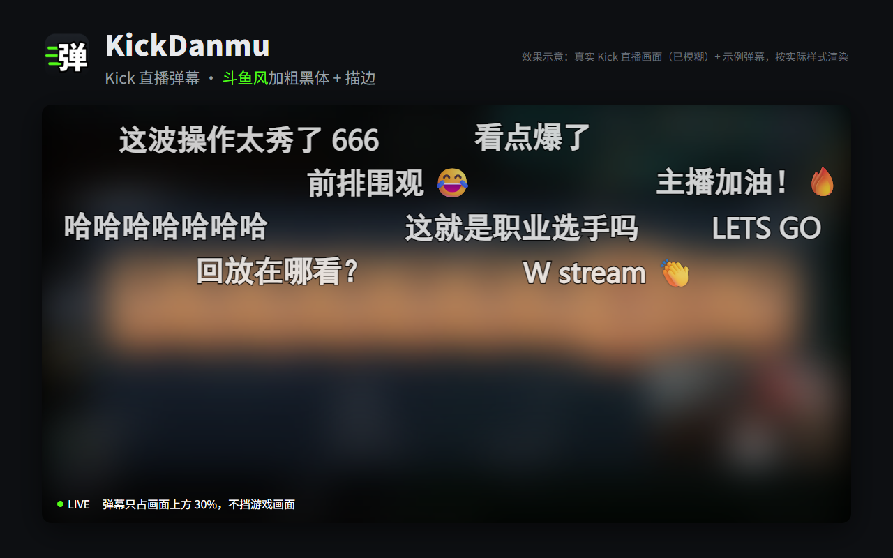
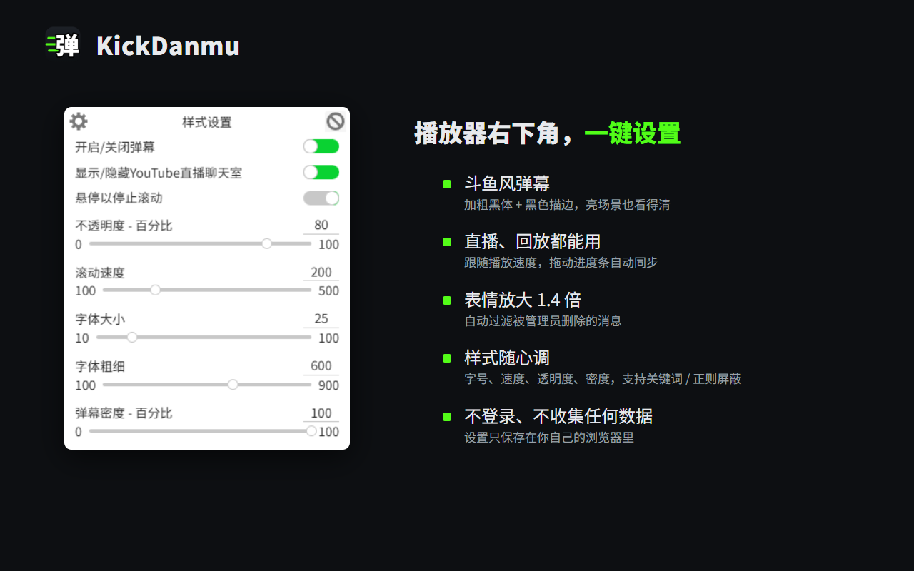

# KickDanmu · Kick 直播弹幕

把 **Kick** 直播和回放的聊天变成**斗鱼风格的飘屏弹幕**：加粗黑体 + 黑色描边，亮场景也看得清。不用登录，不收集任何数据。

Turn **Kick** live and VOD chat into scrolling danmaku (bullet comments). [English below](#english).



## 功能

- **斗鱼风弹幕**：黑体加粗（600）、2px 黑色外描边、80% 不透明，和斗鱼网页版的弹幕字体一致
- **不挡画面**：弹幕只占播放器上方 30%
- **直播、回放都能用**：回放按时间轴同步，跟随播放速度，拖动进度条后自动重新对齐
- **表情放大**：表情按字号的 1.4 倍显示
- **干净**：自动跳过被管理员删除的消息、「新消息」分隔线、回复引用和时间戳
- **随心调**：字号、速度、透明度、密度、字体、粗细都能改；支持关键词 / 正则屏蔽
- 同样支持 **YouTube 直播聊天** 和 **Twitch**



## 安装（约 1 分钟）

1. 到 [Releases](https://github.com/Feeengyuuu/KickDanmu/releases/latest) 下载 `KickDanmu-v1.0.0.zip`，解压到一个之后不会删掉的文件夹。
2. Chrome 地址栏打开 `chrome://extensions`（Edge 打开 `edge://extensions`）。
3. 打开右上角的 **开发者模式**。
4. 点 **加载已解压的扩展程序**，选中刚才解压出来的文件夹（文件夹里能直接看到 `manifest.json`）。
5. 打开任意 Kick 直播间，弹幕就会开始飘。

**更新**：下载新版 zip，解压覆盖原来的文件夹，再到扩展页点 KickDanmu 卡片上的刷新按钮。

## 使用

把鼠标移到播放器上，控制栏右下角会多出一个弹幕按钮，点开就是设置面板：

- **样式设置**：开关弹幕、不透明度、滚动速度、字体大小、字体粗细、弹幕密度、上下留白、字体、是否显示用户名、悬停暂停
- **屏蔽设置**：按关键词或正则表达式屏蔽弹幕

设置按网站分别保存在你自己的浏览器里。

## 隐私

- 不需要登录，不收集、不上传任何数据，没有统计或广告代码。
- 设置只保存在浏览器本地。
- 唯一的网络请求是 Kick 自己的公开聊天接口（回放时、以及页面上没有聊天列表时，用来读取聊天记录）。

详见 [PRIVACY.md](PRIVACY.md)。

## 常见问题

- **没有弹幕？** 刷新一下直播页面；确认扩展页里 KickDanmu 是开启状态，并且「开发者模式」没有关掉。
- **标了 18+ 的直播间**：要先点 Kick 的「已满十八岁」，播放器出来以后弹幕才会出现。
- **Kick 改版后失效**：Kick 经常改网页结构，遇到问题欢迎到 [Issues](https://github.com/Feeengyuuu/KickDanmu/issues) 反馈。

## 从源码构建

```bash
npm install
npm run ext_windows   # Windows
npm run ext_linux     # Linux / macOS
```

打包好的扩展在 `chrome_extension_bin/`，可以直接「加载已解压的扩展程序」。

Kick 相关代码都在 `frontend/chrome_extension/content_script/kick/`：

- `kick_selectors.ts`：扩展依赖的所有 Kick 页面元素，Kick 改版时先改这里
- `kick_api.ts`：用到的 Kick 接口（频道信息、回放信息、聊天记录）
- `kick_assembler.ts`：按页面类型选择聊天来源（直播读聊天列表，回放读聊天记录接口）
- `kick_live_dom_chat_pool.ts` / `kick_live_api_chat_pool.ts` / `kick_vod_chat_pool.ts`：三种聊天来源

调试：在 kick.com 的控制台执行 `localStorage.setItem("kickdanmu:debug", "1")` 并刷新，会打印当前使用的聊天来源。

测试在无头 Chrome 里运行，例如 `npx bundage prun frontend/chrome_extension/content_script/kick/kick_adapter_test`（需要把环境变量 `CHROME` 设为 Chrome 的路径）。

## 致谢与许可

KickDanmu 基于 Yuxuan Xie 的 [DanMage](https://github.com/teststaybaka/danmage) 修改，按 [GPL-3.0-or-later](LICENSE) 发布。

2026 年 10 月的主要改动：重写 Kick 支持（直播 / 回放聊天来源、删除消息过滤、表情尺寸），改为斗鱼风弹幕样式，去掉 DanMage 的登录、云同步和服务器弹幕（YouTube 普通视频与 Crunchyroll 依赖这些功能，因此不再支持），更换名称和图标。仓库里的 `backend/` 和 `frontend/web/` 是 DanMage 原有的服务端和网站代码，扩展本身不再使用。

KickDanmu 是独立项目，与 Kick、斗鱼均无关联。

---

## English

**KickDanmu** shows Kick chat as scrolling danmaku over the player, in a bold, outlined style that stays readable on bright scenes. It works on live streams and VODs (synced to the VOD timeline and playback rate), draws emotes larger, and skips messages deleted by moderators. YouTube live chat and Twitch also work. No sign-in, no tracking, settings stay in your browser.

**Install:** download `KickDanmu-v1.0.0.zip` from [Releases](https://github.com/Feeengyuuu/KickDanmu/releases/latest) and unzip it. Open `chrome://extensions`, turn on **Developer mode**, click **Load unpacked**, and pick the unzipped folder.

**Settings:** hover the player and click the danmaku button at the bottom right of the controls.

KickDanmu is a modified version of [DanMage](https://github.com/teststaybaka/danmage) by Yuxuan Xie, released under GPL-3.0-or-later. Not affiliated with Kick or Douyu.
